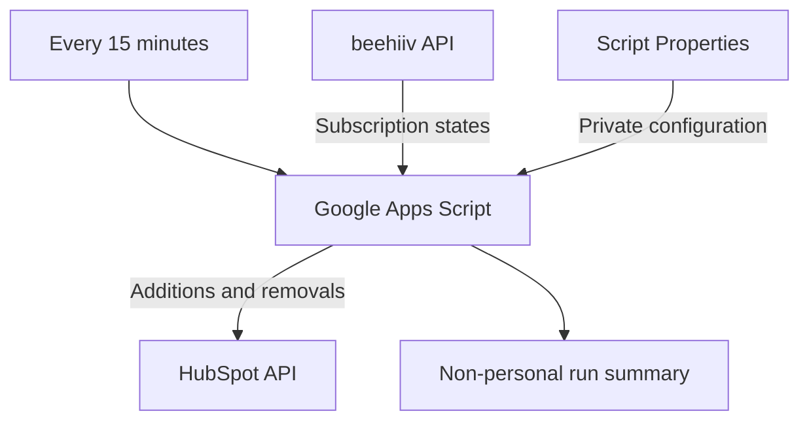
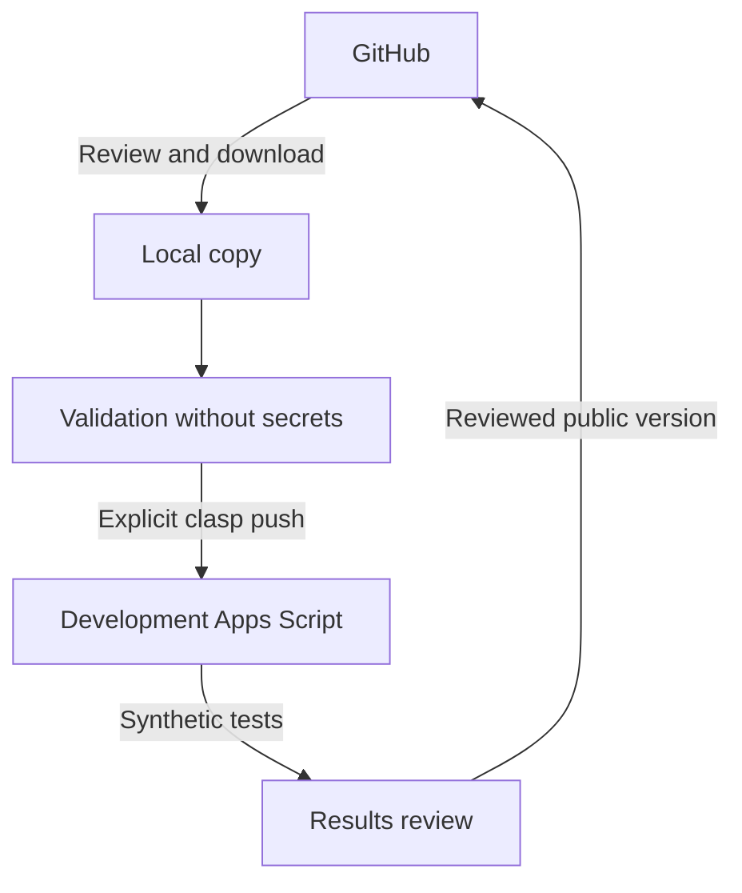

# YaskCode Automations

**Learn · Practice · Build · Share**

An open source initiative by **YaskCode Build**: reusable, documented automations that are free or low cost and run without a self-managed server whenever the execution platform supports it.

[Español](README.md)

> Experimental private preparation — October 16, 2026. Includes an adapted V4 source with dry-run enabled and offline tests. Independent live API installation remains pending. [Installation in Spanish](docs/installation.md) · [Integration](integrations/beehiiv-hubspot/README.md).

## Purpose

Help educators, communities and developers reduce repetitive work through understandable, adaptable solutions. Every automation must explain its behavior, execution environment, permissions, costs, limits and shutdown procedure. Spanish is the primary documentation language, with English access. Unlimited use and permanent third-party compatibility are not promised.

## First real integration: beehiiv → HubSpot

Google Apps Script periodically reads beehiiv and synchronizes subscriber additions and subscription removals to HubSpot. The existing trigger is configured for every 15 minutes. GitHub will hold the reviewed public source; Apps Script remains the primary runtime.

Trigger frequency does not guarantee exact timing or continuous availability. Exact removal behavior, CRM properties, pagination and retries must be established by reviewing the working V4. Bidirectional synchronization is not assumed.

| Component | Responsibility |
| --- | --- |
| beehiiv | Newsletter subscription state source |
| Google Apps Script | Scheduled reads, transformation and API calls |
| HubSpot | Destination CRM contacts and synchronized state |
| GitHub | Versioned source, documentation, reviews and tests |
| clasp | Explicit local file transfer to and from Apps Script |

Secrets stay outside GitHub. Script Properties is not a dedicated secret vault: project editors must be trusted and receive only the access they need.

## Initial catalog

| Automation | Runtime | Public status |
| --- | --- | --- |
| beehiiv → HubSpot | Google Apps Script | Operational source supplied; dry-run adaptation and offline tests |
| Other integrations | Chosen per use case | Roadmap only |

## Four approaches compared

USD reference costs checked October 16, 2026. Confirm current plan, region, taxes and permissions. Connected API costs and limits apply separately.

| Approach | Cost and quotas | Strengths | Limits and suitable use |
| --- | --- | --- | --- |
| Apps Script + GitHub | No additional execution charge within quotas. Apps Script: 6 minutes per run; URL Fetch 20,000/day for consumer accounts and 100,000/day for Workspace; total trigger runtime 90 minutes/day and 6 hours/day respectively. Workspace may require a paid subscription. | Google-hosted execution, Workspace services and versioned code. | Per-user quotas, OAuth and external API limits. Small periodic integrations and education workflows. |
| GitHub Actions | Standard GitHub-hosted runners are free for public repositories. Larger runners, storage and other arrangements have separate rules. | CI, repository maintenance and event-driven jobs. | Scheduled jobs may be delayed or dropped under load; public repository schedules are disabled after 60 days without activity. Not a high-availability clock. |
| n8n Community | No license fee for uses allowed by its Sustainable Use License. Hosting, operations, backups and availability have their own costs. | Visual workflows and complex orchestration. | Requires a running environment. Its license restricts use and is not OSI open source. Suitable when infrastructure can be operated. |
| Zapier | Free: 100 tasks/month, one trigger plus one action, 15-minute polling. Professional advertised from USD 19.99/month billed annually. | Quick setup and managed connectors. | Premium apps, extra steps and higher volumes may require payment. Check the actual connector. Small, simple workflows. |

The current integration uses Apps Script for execution and GitHub for source. Actions will validate changes rather than replace the production trigger.

### Execution budget

A 15-minute interval means approximately 96 runs daily. A consumer account's 90-minute daily trigger allowance gives an average budget of about 56 seconds per run if no other scripts use that quota. This does not replace the individual 6-minute execution cap.

Estimate daily requests as `96 × requests per synchronization`, including pages, searches, writes and retries. beehiiv or HubSpot limits may bind first. API access by service plan must be verified before installation; this project does not claim every free account has sufficient API access.

## Proposed structure

Organize by integration, then runtime, so additional implementations can share functional documentation.

| Planned path | Purpose |
| --- | --- |
| `README.md`, `README.en.md` | Spanish and English entry points |
| `integrations/beehiiv-hubspot/README.md` | Scope, prerequisites, data and operations |
| `integrations/beehiiv-hubspot/apps-script/src/` | Reviewed source and Apps Script manifest |
| `integrations/beehiiv-hubspot/apps-script/config/` | Configuration templates without private values |
| `integrations/beehiiv-hubspot/tests/` | Logic tests and mocked adapters |
| `integrations/beehiiv-hubspot/fixtures/` | Synthetic API responses only |
| `docs/` | Architecture, installation, clasp, privacy, costs and troubleshooting |
| `templates/`, `scripts/` | Integration template and shared validation |
| `.github/workflows/`, `.github/ISSUE_TEMPLATE/` | Validation and safe contribution forms |
| `CONTRIBUTING.md`, `SECURITY.md` | Contribution and private vulnerability reporting |
| `LICENSE`, `LICENSE-docs`, `ROADMAP.md` | Proposed licensing and milestones |

The tree now includes experimental source, a manifest, templates and offline tests; some expansion paths remain proposals.

## GitHub and Apps Script through clasp

clasp transfers local source files to and from Apps Script. It does not make Apps Script run on GitHub or automatically install project triggers.

1. Install a compatible Node.js release and `@google/clasp` following current official documentation; subsequently pin the tool version.
2. Enable the Apps Script API for the development account and authenticate locally with `clasp login`.
3. Create a separate development Apps Script project. Do not select or clone production during this stage.
4. Keep its project ID in a local `.clasp.json`; exclude that file and OAuth credentials from Git.
5. Review `clasp status` before transferring files. Run `clasp push` only against development. Push may overwrite remote files; pull may overwrite local files.
6. Configure test credentials through Script Properties and authorize minimum permissions.
7. Validate with synthetic data and a no-write mode before installing a development trigger.

No automatic production deployment or clasp OAuth credentials in Actions are planned. Exact instructions will follow the recovered code.

## Installation and operation requirements

The installation guide must cover API plan eligibility, scopes, CRM properties, private configuration, manual tests, a single trigger, monitoring, shutdown and recovery. Document configuration names, purpose and required status without real values. Each user creates and authorizes their own project and credentials.

## Consent and privacy

A beehiiv subscription does not by itself authorize every kind of HubSpot communication. Imported newsletter state and HubSpot marketing consent are separate concepts.

Review V4 for email normalization, search before create, duplicate handling, unknown states, preservation of unrelated CRM relationships and prevention of reactivation without consent evidence. Newsletter removal must not automatically erase every CRM relationship.

Define minimum fields, purpose, responsible parties, retention and data-request handling. Never include contact lists, exports or API payloads in repositories, issues, fixtures or CI logs. Use reserved example domains such as `example.com`.

## Publication acceptance criteria

- Retrieve the exact V4 and compare it with the validated copy. Candidate files alone do not establish production equivalence.
- Inspect all proposed files and Git history for tokens, keys, private IDs, emails, headers and logs.
- Exclude `.clasp.json`, `.clasprc.json`, `.env` files, exports and credentials. Gitignore cannot remove secrets already committed.
- Review complete pagination, execution budgets, concurrency, idempotency, partial writes and HTTP 401/403/429/5xx handling.
- Reconcile ambiguous writes before retrying; do not finalize a cursor while failed work remains.
- Test additions, removals, duplicates, reactivation, unknown states, incomplete pagination and recovery with synthetic responses.
- Use read-only CI permissions and no production credentials. Do not execute contributed code through `pull_request_target`.

These are review criteria, not verified V4 features. Automated scanning complements human inspection and cannot prove that every secret is absent.

## Contributing and security

Documentation, translation, accessibility, tests and integration proposals are welcome. Explain source and destination, runtime, cost, quotas, permissions, consent and recovery. Reproduce problems using synthetic data.

A private security reporting channel must be enabled before launch. Do not publish private data in issues. No unconfigured reporting channel is advertised here.

## Proposed licenses

The existing MIT license is retained and also covers documentation in this delivery. CC BY 4.0 for educational material remains a proposal for a later explicit licensing decision, including full notices before adoption. Dependencies and services retain their own terms; project licensing does not change n8n licensing or API terms.

## Roadmap

| Stage | Deliverable | Exit criterion |
| --- | --- | --- |
| 1. Design | Access review, structure and bilingual README | Scope review |
| 2. Recovery | Identified V4 and sanitized public copy | Functional comparison and security review |
| 3. Reproducibility | Guides and mocked tests | Independent development installation |
| 4. Public preparation | Licenses, contribution, security and workflows | Validation and final content review |
| 5. Publication | Public repository and first release | Maintainer's explicit confirmation of reviewed content |
| 6. Expansion | Additional automations | Same quality criteria |

Future ideas include consent-aware activity registration, academic reminders, educational resource collection, GitHub project reports, community metrics and assisted duplicate review. These are proposals rather than implemented integrations or compatibility commitments.

## Support open development

Help by testing, documenting, translating, reporting problems and sharing the project. A voluntary financial support option may be added later. No donation platform or minimum contribution has been selected.

## Official sources

Checked October 16, 2026:

- [Apps Script quotas](https://developers.google.com/apps-script/guides/services/quotas)
- [clasp guide](https://developers.google.com/apps-script/guides/clasp) and [source](https://github.com/google/clasp)
- [Actions billing](https://docs.github.com/en/billing/concepts/product-billing/github-actions)
- [Workflow events and schedules](https://docs.github.com/en/actions/reference/workflows-and-actions/events-that-trigger-workflows)
- [n8n license](https://docs.n8n.io/sustainable-use-license/)
- [Zapier Free](https://help.zapier.com/hc/en-us/articles/32337438839565-What-s-included-in-Zapier-s-Free-plan) and [pricing](https://zapier.com/pricing)

**YaskCode Build · Aprende · Practica · Construye · Comparte**
