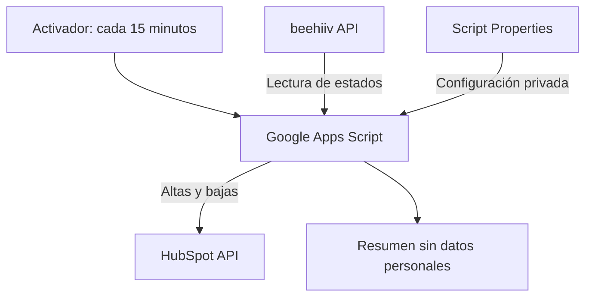
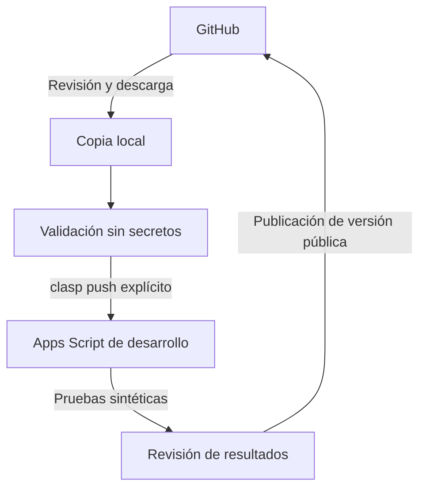

# YaskCode Automations

**Aprende · Practica · Construye · Comparte**

Una iniciativa open source de **YaskCode Build** para aprender, adaptar y compartir automatizaciones gratuitas o de bajo costo, con ejecución sin servidor propio cuando la plataforma lo permita.

[English](README.en.md)

> Borrador de diseño — 16 de octubre de 2026. Repositorio creado como privado; publicación pendiente. La integración V4 funciona en el entorno de su mantenedora, según validación comunicada por ella; su código público y sus pruebas aún no forman parte de esta entrega. No instalar este borrador como integración ejecutable.

## Propósito

Reducir tareas repetitivas en educación, comunidades y productividad mediante soluciones comprensibles y reutilizables. Cada automatización debe explicar qué hace, dónde se ejecuta, qué permisos necesita, cuánto puede costar y cómo detenerla.

El proyecto favorece documentación en español, acceso en inglés, ejemplos sintéticos y decisiones técnicas explícitas. No promete uso ilimitado ni compatibilidad permanente con servicios externos.

## Primer caso real: beehiiv → HubSpot

La integración actual consulta beehiiv desde Google Apps Script y sincroniza altas y bajas hacia HubSpot mediante un activador configurado cada 15 minutos. GitHub será la fuente versionada del código público y Apps Script continuará siendo el ejecutor principal.

La frecuencia configurada no garantiza una ejecución puntual ni disponibilidad continua. El alcance exacto de las bajas, las propiedades CRM, la paginación y los reintentos se documentará después de revisar la V4 funcional. No se presupone sincronización bidireccional.

| Componente | Responsabilidad |
| --- | --- |
| beehiiv | Fuente del estado de suscripción a la newsletter |
| Google Apps Script | Consulta periódica, transformación y llamadas a las API |
| HubSpot | Destino CRM de contactos y estado sincronizado |
| GitHub | Código, documentación, revisión, pruebas y versiones |
| clasp | Transferencia explícita de archivos entre desarrollo local y Apps Script |

Los secretos permanecen fuera de GitHub. Script Properties no sustituye una bóveda de secretos: las personas con acceso al proyecto deben considerarse de confianza y recibir únicamente los permisos necesarios.

## Catálogo inicial

| Automatización | Ejecutor | Estado público |
| --- | --- | --- |
| beehiiv → HubSpot | Google Apps Script | Dos candidatos revisados; cotejo con producción pendiente |
| Otras integraciones | Según cada caso | Hoja de ruta; sin código disponible |

## Cuatro alternativas de automatización

Costos de referencia en USD, consultados el 16 de octubre de 2026. Las cuotas pueden cambiar; confirmar plan, región, impuestos y permisos antes de usar. El costo de las API conectadas se evalúa por separado.

| Alternativa | Costo y cuotas | Ventajas | Límites y uso recomendado |
| --- | --- | --- | --- |
| Google Apps Script + GitHub | Sin tarifa de ejecución adicional dentro de cuotas. Apps Script: 6 min por ejecución; URL Fetch 20.000 llamadas/día en cuentas personales y 100.000 en Workspace; activadores: 90 min/día y 6 h/día respectivamente. Workspace puede requerir suscripción. | Alojamiento de Google, acceso a servicios Workspace, código versionado. | Cuotas por usuario, permisos OAuth y API externas. Adecuado para integraciones pequeñas y tareas docentes periódicas. |
| GitHub Actions | Runners estándar alojados por GitHub gratuitos en repositorios públicos; runners grandes, almacenamiento y otras modalidades tienen reglas propias. | CI, pruebas, mantenimiento de repositorios y tareas por eventos. | Programaciones pueden retrasarse o descartarse bajo carga; en repositorios públicos se desactivan tras 60 días sin actividad. No es un reloj de alta disponibilidad. |
| n8n Community | Sin tarifa de licencia para usos permitidos por su Sustainable Use License; alojamiento, mantenimiento, copias y disponibilidad tienen costo propio. | Editor visual y flujos complejos con muchas integraciones. | Necesita un entorno de ejecución propio o contratado. Su licencia tiene restricciones de uso y no es una licencia open source OSI. Adecuado cuando se puede operar infraestructura. |
| Zapier | Free: 100 tareas/mes, flujos de un disparador y una acción, consulta periódica de 15 min. Professional desde USD 19,99/mes con facturación anual según oferta consultada. | Inicio rápido y conectores gestionados. | Apps premium, pasos adicionales y volumen pueden requerir pago; verificar cada conector. Adecuado para flujos sencillos de poco volumen. |

Para el caso actual elegimos Apps Script como ejecutor y GitHub como fuente de código. Actions validará cambios; no sustituirá el activador de producción.

### Presupuesto de ejecución

Cada 15 minutos equivale aproximadamente a 96 ejecuciones al día. Con una cuenta personal, 90 minutos diarios de activadores representan unos 56 segundos por ejecución en promedio, si ninguna otra tarea consume esa cuota. No es un límite individual nuevo: cada ejecución conserva el máximo de 6 minutos.

Estimar llamadas diarias como `96 × llamadas por sincronización`, incluyendo paginación, búsquedas, escrituras y reintentos. La escala puede quedar limitada por las API de beehiiv o HubSpot antes que por Apps Script. La disponibilidad y los límites de esas API en cada plan se verificarán en la guía de instalación; no se afirma que toda cuenta gratuita incluya acceso suficiente.

## Estructura propuesta

La organización lógica será por integración y luego por ejecutor. Así, una integración podrá incorporar otra implementación sin duplicar su explicación funcional.

| Ruta prevista | Contenido |
| --- | --- |
| `README.md`, `README.en.md` | Presentación y entrada en ambos idiomas |
| `integrations/beehiiv-hubspot/README.md` | Alcance, datos, requisitos y operación |
| `integrations/beehiiv-hubspot/apps-script/src/` | Código público revisado y manifiesto Apps Script |
| `integrations/beehiiv-hubspot/apps-script/config/` | Plantillas sin valores privados |
| `integrations/beehiiv-hubspot/tests/` | Pruebas de lógica y adaptadores simulados |
| `integrations/beehiiv-hubspot/fixtures/` | Respuestas API exclusivamente sintéticas |
| `docs/` | Arquitectura, instalación, clasp, privacidad, costos y problemas |
| `templates/` | Plantilla para nuevas automatizaciones |
| `scripts/` | Validaciones comunes del repositorio |
| `.github/workflows/` | Validación de código, documentación y secretos |
| `.github/ISSUE_TEMPLATE/` | Reportes y propuestas sin datos privados |
| `CONTRIBUTING.md`, `SECURITY.md` | Contribución y reporte privado de vulnerabilidades |
| `LICENSE`, `LICENSE-docs` | Licencias propuestas, pendientes de adopción |
| `ROADMAP.md` | Entregas y criterios de aceptación |

Estas rutas son un diseño; esta entrega contiene los README y el plan de revisión, no un árbol ejecutable completo.

## GitHub y Apps Script con clasp

`clasp` permite trabajar con archivos locales y transferirlos a Apps Script. No hace que Apps Script se ejecute desde GitHub ni instala por sí solo los activadores del proyecto.

Flujo de desarrollo previsto:

1. Instalar Node.js compatible y `@google/clasp` según la documentación vigente; fijar después la versión en las herramientas del proyecto.
2. Habilitar Apps Script API en la cuenta de desarrollo y autenticar `clasp login` localmente.
3. Crear un proyecto de Apps Script independiente para pruebas. No seleccionar ni clonar producción durante esta etapa.
4. Configurar localmente `.clasp.json` con el identificador del proyecto de desarrollo. Excluir ese archivo y los archivos OAuth de Git.
5. Revisar `clasp status` antes de cualquier transferencia; usar `clasp push` solo contra desarrollo. `push` puede sobrescribir archivos remotos y `pull` puede sobrescribir archivos locales.
6. Establecer credenciales de prueba mediante Script Properties y autorizar los permisos mínimos.
7. Validar con datos sintéticos y un modo sin escrituras antes de instalar un activador de desarrollo.

El repositorio no incluirá despliegue automático a producción ni credenciales OAuth para clasp en Actions. Las instrucciones exactas se ajustarán al código recuperado.

## Instalación y operación: contrato documental

La futura guía deberá cubrir acceso API por plan, permisos mínimos, propiedades CRM, configuración privada, ejecución manual de prueba, activador único, monitoreo, desactivación y recuperación. Se documentará cada propiedad por nombre, finalidad y obligatoriedad, nunca con su valor real.

Un archivo de código no constituye una instalación completa: cada persona debe crear y autorizar su proyecto y configurar sus propias credenciales.

## Consentimiento y privacidad

Una suscripción a beehiiv no constituye por sí sola autorización para cualquier comunicación desde HubSpot. El estado de suscripción importado y el consentimiento de marketing de HubSpot deben tratarse como conceptos separados.

La revisión de V4 debe comprobar: normalización de correo, búsqueda antes de crear, tratamiento de duplicados, prohibición de reactivar bajas sin evidencia, estados desconocidos y preservación de otras relaciones del contacto. Una baja de newsletter no debe implicar automáticamente borrar todas sus relaciones CRM.

Definir campos mínimos, finalidad, responsables, plazo de conservación y proceso de atención de solicitudes. No guardar listas de contactos, exportaciones ni cuerpos API en el repositorio, issues, fixtures o logs de CI. Los ejemplos utilizarán dominios reservados como `example.com`.

## Seguridad y calidad antes de publicar

- Confirmar la V4 exacta y compararla con la copia validada; los archivos candidatos todavía no son evidencia de equivalencia con producción.
- Revisar todo el contenido y el historial que vaya a publicarse: tokens, claves, IDs privados, correos, cabeceras y registros.
- Excluir `.clasp.json`, `.clasprc.json`, archivos `.env`, exportaciones y credenciales; `.gitignore` no elimina secretos ya versionados.
- Revisar paginación completa, límites de ejecución, concurrencia, idempotencia, errores 401/403/429/5xx y escrituras parciales.
- No repetir escrituras de resultado ambiguo sin reconciliar primero; no avanzar un cursor definitivo tras fallos pendientes.
- Probar con respuestas sintéticas: altas, bajas, duplicados, reactivaciones, estados desconocidos, paginación incompleta y reanudación.
- No usar `pull_request_target` para ejecutar código de contribuciones; CI tendrá permisos de lectura y ninguna credencial de producción.

Estas son condiciones de aceptación, no funcionalidades verificadas de la V4. Una revisión automática complementa la inspección humana y no demuestra ausencia total de secretos.

## Contribuir

Se aceptarán mejoras de documentación, pruebas, accesibilidad, traducciones y nuevas integraciones. Cada propuesta deberá indicar origen y destino, ejecutor, costo, cuotas, permisos, modelo de consentimiento y estrategia de recuperación. Compartir un ejemplo reproducible con datos sintéticos.

Para fallos de seguridad, utilizar el canal privado que se habilite antes del lanzamiento; no publicar vulnerabilidades con datos privados en un issue. No se anuncia todavía un canal que no exista.

## Licencias propuestas

La licencia MIT existente se conserva. Para esta entrega también cubre la documentación. Se propone evaluar CC BY 4.0 para el material educativo en una decisión posterior, con sus textos y avisos antes de adoptarla. Dependencias y plataformas conservan sus propias licencias; la licencia del proyecto no modifica la de n8n ni los términos de las API.

## Hoja de ruta

| Etapa | Entrega | Criterio de salida |
| --- | --- | --- |
| 1. Diseño | Acceso, estructura, README bilingüe | Revisión de alcance y pendientes |
| 2. Recuperación | V4 identificada y copia pública saneada | Cotejo funcional y revisión de seguridad |
| 3. Reproducibilidad | Guías y pruebas con simulaciones | Instalación en desarrollo independiente |
| 4. Preparación pública | Licencias, contribución, seguridad y workflows | Validación de contenido y revisión final |
| 5. Publicación | Publicar repositorio y primera versión | Confirmación expresa de la mantenedora sobre contenido revisado |
| 6. Expansión | Nuevas automatizaciones | Aplicar los mismos criterios de calidad |

Ideas futuras: formularios de inscripción a actividades con consentimiento; recordatorios académicos; consolidación de recursos educativos; reportes de proyectos GitHub; resúmenes de métricas comunitarias y limpieza de duplicados asistida. Son propuestas, no compromisos de compatibilidad ni integraciones implementadas.

## Apoyar el desarrollo abierto

Puedes apoyar probando ejemplos, mejorando documentación, traduciendo, reportando problemas o compartiendo el proyecto. En el futuro podrá habilitarse una vía voluntaria de apoyo económico. Todavía no se ha elegido plataforma ni se establece un aporte mínimo.

## Fuentes oficiales

Consultadas el 16 de octubre de 2026:

- [Cuotas de Apps Script](https://developers.google.com/apps-script/guides/services/quotas)
- [clasp en Apps Script](https://developers.google.com/apps-script/guides/clasp)
- [Código y documentación de clasp](https://github.com/google/clasp)
- [Facturación de GitHub Actions](https://docs.github.com/en/billing/concepts/product-billing/github-actions)
- [Eventos y programación de workflows](https://docs.github.com/en/actions/reference/workflows-and-actions/events-that-trigger-workflows)
- [Licencia de n8n](https://docs.n8n.io/sustainable-use-license/)
- [Plan gratuito de Zapier](https://help.zapier.com/hc/en-us/articles/32337438839565-What-s-included-in-Zapier-s-Free-plan)
- [Precios de Zapier](https://zapier.com/pricing)

**YaskCode Build · Aprende · Practica · Construye · Comparte**
