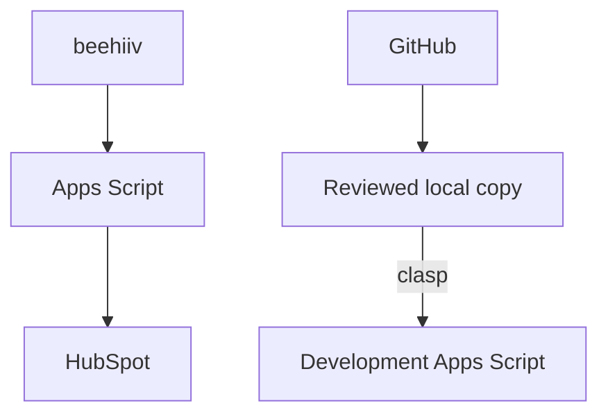

# Architecture and boundaries

[Español](architecture.md)

GitHub stores reviewed source. Google Apps Script executes the integration. clasp explicitly transfers source to an independent development project. There is no automatic production deployment.

This separates operational data flow from development flow. Imported newsletter state does not itself modify HubSpot native marketing consent. See [V4 review](v4-review.en.md) for behavior and limits.
