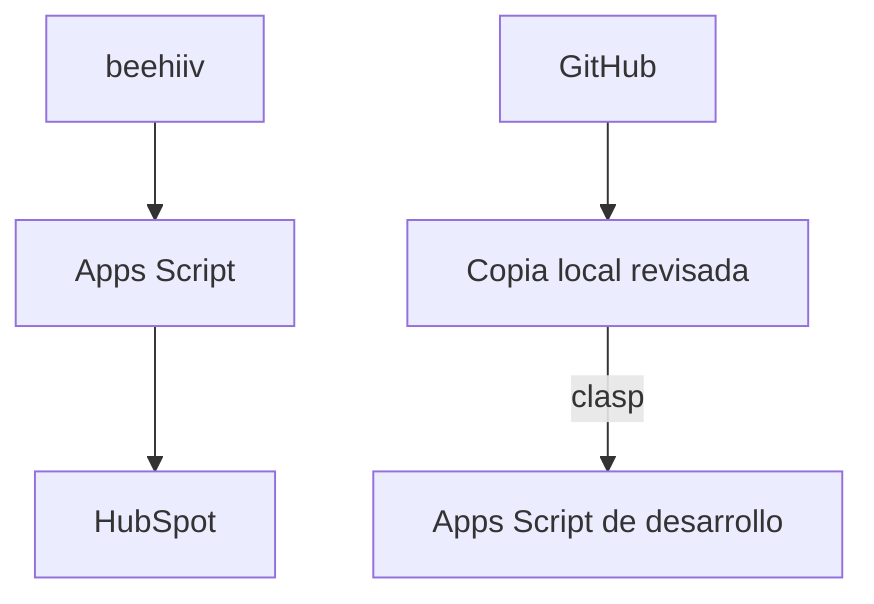

# Arquitectura y límites

GitHub conserva la fuente revisada. Google Apps Script ejecuta la integración. clasp transfiere archivos explícitamente a un proyecto independiente de desarrollo. No hay despliegue automático a producción.

El diagrama separa el flujo de datos operativo del flujo de desarrollo. El estado importado de newsletter no cambia por sí mismo el consentimiento nativo de marketing de HubSpot.

Ver [revisión de candidatos V4](v4-review.md). El contrato definitivo de campos y errores depende de cotejar la copia funcional.
