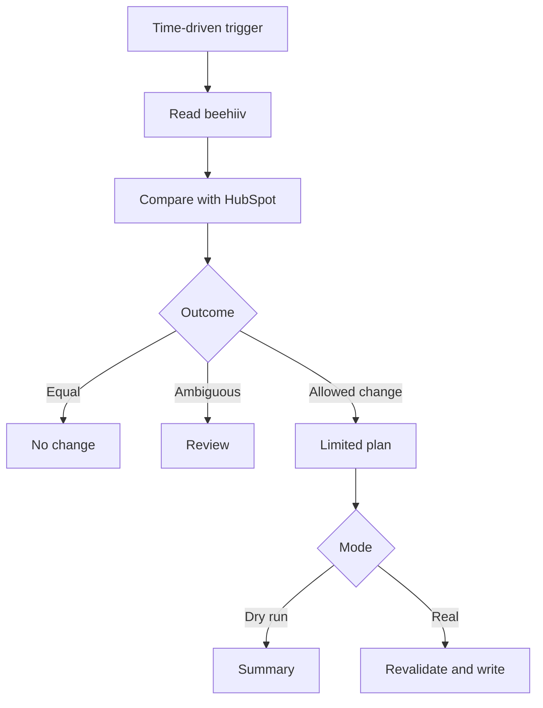

# Learning model: from theory to results

[Español](learning-model.md)

YaskCode Automations combines five dimensions so each integration is both a technical solution and a reproducible learning experience.

| Dimension | Question | Deliverable |
| --- | --- | --- |
| Theory | How and why does it work? | Concepts, architecture, limits and sources |
| Comparison | When should this approach be chosen? | Costs, quotas, permissions, latency and operations |
| Practice | How is it built and tested? | Guided exercises and simulations |
| Application | Which real problem does it solve? | Use case, purpose, data and consent rules |
| Results | What evidence supports the outcome? | Method, metrics, limits and reproducible evidence |

## Automation vocabulary

Trigger and the Spanish word disparador mean the same thing: what starts a workflow. An action performs work; a filter determines whether to continue; a transformation adapts data; state remembers progress; reconciliation compares systems to recover consistency.

In V4 a time-driven trigger starts a beehiiv query. Code detects changes by comparing them with HubSpot. The trigger does not receive a subscription event and does not know whether someone subscribed.

## Replacing activation mechanisms

Replace the mechanism that starts or detects work, then preserve or adapt the functional contract. An action is not a substitute for a trigger.

| Need | Apps Script | GitHub Actions | n8n / Zapier | Review |
| --- | --- | --- | --- | --- |
| Periodic execution | Installable time-driven trigger | schedule event | Scheduling or polling trigger, depending on plan | Timing, delays and quotas |
| Spreadsheet change | Installable edit event when authorization is required | External bridge needed for Sheets edits | Compatible sheet connector | Event coverage and execution identity |
| Google Form submission | Installable submission event | External bridge needed | Compatible connector | Identity, permissions and consent |
| External event | doPost web app if authentication and payload are compatible | Authorized API/event such as repository_dispatch | Webhook or connector depending on plan | Source validation, duplicates and limits |
| Human execution | Authorized function execution | workflow_dispatch | Manual development execution | Credentials, effects and traceability |

Simple Apps Script triggers such as onEdit have authorization restrictions and cannot directly replace V4's authorized execution. Script/API cell changes do not automatically trigger onEdit. Installable triggers run as their creator; transferring source with clasp does not transfer installed triggers.

A webhook needs a compatible sender and receiver. doPost is not universal: assess signature verification, available headers/data and whether an intermediary is required. V4 has no webhook receiver.

Moving from polling to events requires an event/payload contract, authenticated origin, normalization, duplicate prevention, out-of-order handling and reconciliation for lost events. Test outside production and plan cutover to avoid two writers. These are future design requirements, not implemented features.

## Three response classifications

| Layer | Examples | Meaning |
| --- | --- | --- |
| HTTP | 200, 201, 401, 403, 429, 5xx | API exchange outcome |
| Domain | active, inactive, pending | Provider subscription state |
| Execution | sinCambios, actualizar, casosEnRevision | Internal decision or outcome |

HTTP 200 proves neither consent nor the expected business transformation. Inactive does not necessarily identify why a subscription became inactive. A planned creation is not an applied creation.

| Response or situation | Learning policy and current V4 behavior |
| --- | --- |
| HTTP 200 / 201 | Validate response and expected effect; V4 checks write confirmations |
| HTTP 204 | May be empty success for other APIs; V4 expects 201 for create and 200 for update |
| HTTP 400 / 422 | Correct input or contract before retrying |
| HTTP 401 / 403 | Check authentication, permissions and plan; V4 stops |
| HTTP 404 | Check resource and access; do not automatically infer deletion |
| HTTP 409 | Reconcile conflict/duplicate rather than blindly creating again |
| HTTP 429 / 500 / 502 / 503 / 504 | V4 retries reads up to three attempts; no automatic write retries |
| Ambiguous write or timeout | Inspect destination before retrying; V4 stops and has no durable queue |
| Unknown state or multiple contacts | V4 blocks the batch for review |
| Inactive contact becomes active | V4 sets reactivation aside for consent verification |

Recommended policy can exceed current implementation. Retry-After handling, a time budget and durable reconciliation remain pending.

## Guided practice

1. Draw source, runtime, destination and configuration storage.
2. Run the 14 offline tests and explain the risk each checks.
3. Introduce synthetic duplicates, incomplete pages and unknown states.
4. Explain why planned changes and applied operations may differ.
5. Estimate requests and runtime for 10, 100 and 500 contacts, including rereads and retries.
6. Design a webhook variant without activating it; justify authentication.

## Results and evidence

| Indicator | Method | Current status |
| --- | --- | --- |
| Operational installation | Maintainer verification | Additions/removals verified by her; 15-minute interval configured |
| Distributed copy | Mocked-service tests | 14 local tests passed; initial CI run passed |
| Independent installation | Follow guide in a new project | Pending |
| Actual latency | Source event to confirmed destination effect | Unmeasured; configured interval is not guaranteed latency |
| Runtime and requests | Non-personal measurements | Instrumentation pending |
| Deferred/blocked work | Run summary | Counters exist; no persistent queue |
| Time/money saved | Manual baseline against equivalent workload | Unmeasured; do not invent percentages |

Separate maintainer-reported production observations, static review, mocked results and independent measurements. Publish aggregate evidence, date, version and conditions without contacts or secrets.

## Sources

Checked October 16, 2026:

- https://developers.google.com/apps-script/guides/triggers
- https://developers.google.com/apps-script/guides/triggers/installable
- https://developers.google.com/apps-script/guides/web
- https://docs.github.com/en/actions/reference/workflows-and-actions/events-that-trigger-workflows
- https://www.rfc-editor.org/rfc/rfc9110
- https://www.rfc-editor.org/rfc/rfc6585

[References and collaboration](ecosystem.en.md)
