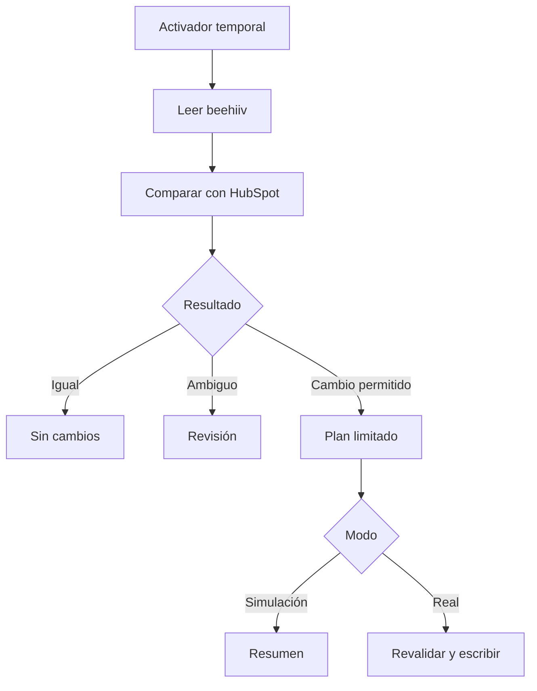

# Modelo educativo: de la teoría a los resultados

[English](learning-model.en.md)

YaskCode Automations propone estudiar y construir automatizaciones con cinco dimensiones: teoría, comparación, práctica, aplicación y resultados. Cada integración debe servir como solución técnica y experiencia de aprendizaje reproducible.

## Las cinco dimensiones

| Dimensión | Pregunta | Entregable |
| --- | --- | --- |
| Teoría | ¿Cómo y por qué funciona? | Conceptos, arquitectura, límites y fuentes |
| Comparación | ¿Cuándo conviene esta alternativa? | Costos, cuotas, permisos, latencia y operación |
| Práctica | ¿Cómo se construye y prueba? | Guía gradual, simulaciones y ejercicios |
| Aplicación | ¿Qué problema real resuelve? | Caso, propósito, datos y reglas de consentimiento |
| Resultados | ¿Qué evidencia demuestra lo conseguido? | Método, métricas, limitaciones y resultados reproducibles |

## Vocabulario de automatización

Disparador y trigger son el mismo concepto en dos idiomas: lo que inicia un flujo. La acción es lo que se hace después. Un filtro decide si continuar; una transformación adapta datos; el estado permite recordar progreso; la reconciliación compara sistemas para recuperar consistencia.

En V4 el activador temporal inicia una consulta a beehiiv. La detección de cambios ocurre en el código al comparar con HubSpot. El activador no recibe un evento de nueva suscripción y no sabe si alguien se dio de alta.

## Sustituir mecanismos de activación

No se sustituye un trigger por una acción; se reemplaza el mecanismo que inicia o detecta trabajo y se conserva o adapta el contrato funcional.

| Necesidad | Apps Script | GitHub Actions | n8n / Zapier | Qué debe revisarse |
| --- | --- | --- | --- | --- |
| Ejecución periódica | Activador temporal instalable | Evento schedule | Disparador de calendario o sondeo, según plataforma/plan | Frecuencia, retrasos y cuotas |
| Cambio en hoja | Evento de edición instalable cuando requiere autorización | Sin equivalencia directa a edición de Sheets; necesita puente externo | Conector de hoja con sondeo o eventos | Qué cambios producen el evento y quién ejecuta |
| Envío de formulario Google | Activador de envío instalable | Necesita un puente | Conector compatible | Identidad, permisos y consentimiento |
| Evento externo inmediato | Aplicación web doPost, si el contrato y la autenticación son compatibles | Evento/API autorizado, por ejemplo repository_dispatch | Webhook/conector según plan | Validación de origen, duplicados y límites |
| Ejecución humana | Ejecutar función autorizada | workflow_dispatch | Ejecución manual de desarrollo | Credenciales, efectos y trazabilidad |

Los triggers simples de Apps Script, como onEdit, tienen restricciones de autorización y no son un reemplazo directo del activador autorizado de nuestra integración. Los cambios de celdas hechos por scripts/API no disparan automáticamente onEdit. Los activadores instalables se ejecutan bajo la cuenta que los creó; copiar código con clasp no copia esos activadores.

Un webhook requiere un emisor compatible y un receptor. doPost no ofrece una sustitución universal: debe evaluarse cómo verificar la firma, qué cabeceras o datos están disponibles en Apps Script y si hace falta un intermediario. V4 no implementa webhooks.

Para migrar sondeo a eventos: definir evento/payload, autenticar origen, normalizar datos, evitar procesar duplicados, manejar eventos fuera de orden y reconciliar pérdidas. Probar fuera de producción y acordar el corte para evitar dos escritores. Son requisitos de una futura variante, no funciones existentes.

## Clasificación de respuestas: tres capas diferentes

| Capa | Ejemplos | Interpretación |
| --- | --- | --- |
| HTTP | 200, 201, 401, 403, 429, 5xx | Resultado del intercambio con una API |
| Dominio | active, inactive, pending | Estado de suscripción según el contrato del proveedor |
| Ejecución | sinCambios, actualizar, casosEnRevision | Decisión o resultado interno de nuestra automatización |

Un HTTP 200 no demuestra consentimiento ni que se aplicó la transformación esperada. Un `inactive` no identifica necesariamente el motivo de la baja. Un plan de creación no es una creación aplicada.

| Respuesta o situación | Política didáctica y comportamiento V4 |
| --- | --- |
| HTTP 200 / 201 | Validar cuerpo y efecto esperado; V4 comprueba confirmaciones de escrituras |
| HTTP 204 | Puede ser éxito sin cuerpo en otras API; V4 espera 201 al crear y 200 al actualizar |
| HTTP 400 / 422 | Revisar entrada y contrato; no reintentar sin corregir |
| HTTP 401 / 403 | Revisar autenticación, permisos y plan; V4 detiene el proceso |
| HTTP 404 | Revisar recurso y acceso; no concluir automáticamente que fue borrado |
| HTTP 409 | Reconciliar conflicto o duplicado; no crear nuevamente a ciegas |
| HTTP 429 / 500 / 502 / 503 / 504 | V4 reintenta lecturas hasta tres intentos; no reintenta escrituras automáticamente |
| Timeout o respuesta ambigua al escribir | Consultar destino antes de repetir; V4 detiene, no tiene una cola durable |
| Estado desconocido / varios contactos | V4 bloquea el lote para revisión |
| Inactivo pasa a activo | V4 aparta la reactivación para comprobar consentimiento |

La política recomendada puede ser más amplia que la implementación. En particular, Retry-After, presupuesto de tiempo y reconciliación durable siguen pendientes. Estas tablas no amplían las funciones del motor.

## Práctica guiada

1. Dibujar fuente, ejecutor, destino y almacén de configuración.
2. Ejecutar las 14 pruebas locales y explicar qué riesgo comprueba cada una.
3. Introducir respuestas sintéticas: duplicado, página incompleta y estado desconocido.
4. Comparar plan frente a operaciones aplicadas: ¿por qué no tienen que ser iguales?
5. Estimar llamadas y tiempo para 10, 100 y 500 contactos, incluyendo relecturas y reintentos.
6. Diseñar, sin activar, una variante basada en webhooks y justificar su autenticación.

## Resultados y evidencia

| Indicador | Cómo obtenerlo | Situación actual |
| --- | --- | --- |
| Instalación operativa | Verificación de la mantenedora | Altas y bajas verificadas por ella; intervalo configurado de 15 min |
| Copia distribuida | Pruebas con servicios simulados | 14 pruebas locales aprobadas y primera ejecución de CI aprobada |
| Instalación independiente | Seguir la guía en un proyecto nuevo | Pendiente |
| Latencia real | Diferencia entre evento fuente y efecto confirmado | No medida; 15 min de frecuencia no es latencia garantizada |
| Duración y llamadas por ciclo | Medición sin datos personales | Pendiente de instrumentación |
| Pendientes y bloqueos | Resumen de ejecución | Contadores existentes; no son una cola persistente |
| Ahorro de tiempo/dinero | Línea base manual y mismo volumen automatizado | No medido; no atribuir porcentajes inventados |

Distinguir siempre observación de producción comunicada por la mantenedora, inspección de código, resultado simulado y medición independiente. Publicar evidencia agregada, fecha, versión y condiciones, sin contactos ni tokens.

## Fuentes

Consultadas el 16 de octubre de 2026:

- https://developers.google.com/apps-script/guides/triggers
- https://developers.google.com/apps-script/guides/triggers/installable
- https://developers.google.com/apps-script/guides/web
- https://docs.github.com/en/actions/reference/workflows-and-actions/events-that-trigger-workflows
- https://www.rfc-editor.org/rfc/rfc9110
- https://www.rfc-editor.org/rfc/rfc6585

[Referentes y colaboración](ecosystem.md)
